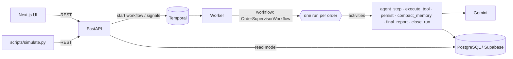

# Architecture note

## Shape of the system



- **One Temporal workflow per order.** The workflow id is `order-supervisor-{order_id}` and starts with
  `WorkflowIDConflictPolicy.FAIL`, so Temporal itself guarantees a single live supervisor per order.
- **The workflow is the source of truth; Postgres is the read model.** The workflow owns orchestration state
  (memory, schedule, pause flag, pending events). After each state change it writes a snapshot plus the new timeline
  entries through the `persist` activity, so the UI never queries a running workflow and history outlives it.
- **All I/O lives in activities**, so the workflow code stays deterministic and replay-safe: LLM calls, simulated
  tools, database writes.

## Lifecycle and the three inference triggers

```
start ──► agent turn ──► sleep ──┬─ important event signal ──► agent turn ──► sleep ...
                                 ├─ scheduled wake-up time  ──► agent turn ──► sleep ...
                                 ├─ operator interrupt      ──► agent turn ──► sleep ...
                                 └─ terminal event / close_workflow / terminate ──► final report ──► done
```

Sleeping is `workflow.wait_condition(..., timeout=next_wake_at - now)`. Signals append to an inbox, and the
condition wakes the loop. The loop then:

1. drains the inbox: updates the order status, logs each event, and runs the **wake-up policy** on it;
2. checks whether the scheduled wake-up time has passed;
3. runs one **agent turn** for the highest-priority pending wake reason
   (`terminal > manual > event > scheduled`). Several events that arrive together collapse into one turn.

**Wake-up policy** (`agent/classifier.py`): a deterministic rule set, so it is free, explainable in the timeline
and safe to run inside the workflow.

| Event | Decision |
|---|---|
| Terminal (`delivered`, `refund_completed`, `order_cancelled`) | wake now; the run closes after that turn |
| Critical (`payment_failed`, `shipment_delayed`, `refund_requested`, `customer_message_received`) | always wake now |
| **Unknown event types** | wake now and flag as unknown; the prompt tells the agent to escalate if unclear |
| `no_update_for_n_hours` | wakes once N passes the threshold for the aggressiveness level (48h / 24h / 6h) |
| Routine events | deferred to the next scheduled wake; `high` aggressiveness wakes on everything |

The agent tunes this per run with the `set_wake_guidance` tool (`wake_on` / `ignore` lists). This is the
"agent-generated wake-up guidance for the classifier".

## Agent turn

Each model call is its own activity (`agent_step`), and each tool call is its own activity or in-workflow step.
A turn is a bounded loop of at most 6 model steps:
`model → tool calls → results back to model → ...`, which ends when the model stops calling tools, schedules its
sleep, or closes the run.

- **Action tools** (`send_customer_message`, `create_internal_note`, `escalate_issue`, `mark_order_for_review`)
  run in the `execute_tool` activity with an idempotency key (`run:generation:turn:step:index`). The key is
  **claimed in the `tool_executions` table before acting**, so a retry or a concurrent attempt never sends a message
  twice; a real integration would also pass the key downstream. The tools are simulated, and the table doubles as
  an outbox the UI shows.
- **Control tools** (`schedule_next_wake`, `update_memory`, `set_wake_guidance`, `close_workflow`) change
  workflow state directly and deterministically. Sleep length is clamped to the supervisor's `max_sleep_minutes`.
  If the agent doesn't choose a wake-up time, it gets the supervisor's default.
- Run-specific instructions arrive by signal and are added to the system prompt from the next model call on,
  with an option to wake the agent immediately.

## Memory and timeline

- **Timeline** (DB): every event, policy decision, wake, reasoning step, tool call, sleep, instruction,
  control action and memory change, flagged `important` where relevant.
- **Workflow memory**: a compact `memory_summary` that the agent rewrites with `update_memory`, plus a short list
  of recent important items. When that list passes 16 items, the oldest are **compacted** into the summary by an
  LLM call (`compact_memory`) and the 6 newest are kept verbatim. If the LLM fails, a plain-text trail is used
  instead, so history is never lost.
- **Bounded history**: when the event history passes a threshold, or Temporal suggests it, the workflow
  `continue_as_new`s with all of its state carried over. It only does so when it is idle (empty inbox, all
  handlers finished), so no signal is dropped.

## Human control

| Control | Mechanism |
|---|---|
| Pause / resume | Signal. While paused, events are still recorded and classified, but no turns run and scheduled wake-ups are held. On resume the held wake reason runs. |
| Interrupt | Signal. Wakes the agent now for a review, with an optional operator note. |
| Terminate | Signal, not a hard Temporal terminate, so the workflow still writes its **final report** before closing. |

## End-of-run output

`generate_final_report` asks the model for structured JSON with these keys: `summary`, `outcome`,
`key_actions`, `learnings`, `recommendations`. If the LLM is unavailable, the workflow builds a basic report from
its own state, so a run always closes cleanly.

## Failure handling

- LLM calls retry with backoff on rate limits and server errors. The Gemini adapter **falls back to the next
  model** when one is busy or out of free-tier quota. Errors that can't recover (a bad key, the daily quota used
  up on every model) are not retried.
- A failed agent turn is logged in the timeline and the agent sleeps for the default interval. The workflow
  never crashes because the LLM did.
- Database writes retry until they succeed, so timeline entries are not lost during a database outage.
  If the run row itself is missing (for example, the database was reset), persistence is skipped rather than
  blocking the workflow forever.
- The API keeps the database and Temporal consistent. A partial unique index allows only one open run per order.
  A start that fails marks the run `failed`. If the database says a run is open but its workflow is gone, the run
  is released.

## Trade-offs and next steps

- The wake-up policy is rule-based on purpose. A small LLM classifier for free-text customer messages
  (urgent vs. "thanks!") would be the next improvement.
- The UI polls every 2s. Server-sent events would be the next step at scale.
- Tables are created with `create_all` at startup. A real deployment would use Alembic migrations.
- Timeline writes are at-least-once: if a database commit succeeds but its acknowledgement is lost, a retry can add a
  duplicate timeline row. Deterministic entry ids would make this exactly-once.
- No auth or multi-tenancy, per the brief's scope.
